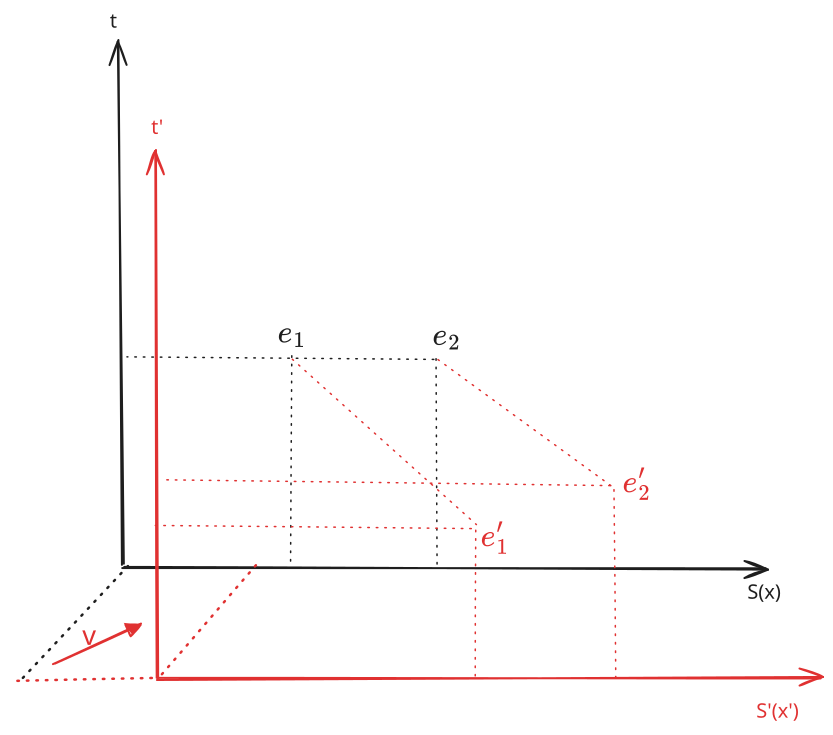
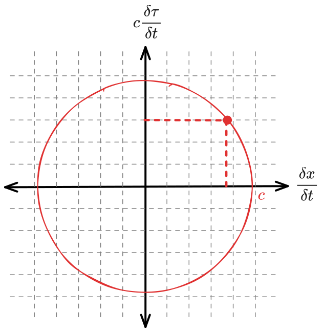

## 1. What is General Relativity
Special Relativity (1905) merged space and time into a single four-dimensional spacetime. General Relativity, published by Einstein in 1915, goes one step further: spacetime is not a fixed stage but a curved geometry, shaped by the energy and matter within it. In this picture gravity is not a pulling force. A freely falling object is simply following the straightest possible path through curved spacetime, called a geodesic, in the same way an object in empty space moves in a straight line at constant speed when nothing acts on it.

John Wheeler summarized the two halves of the theory in one sentence: spacetime tells matter how to move, and matter tells spacetime how to curve.

## 2. Spacetime, worldline and proper time

### 2.1 Spacetime
Similar to how we define a position in one-dimension vector via $x$, two-dimension plane surface via $(x,y)$ and three-dimension space via $(x,y,z)$, we label an event in spacetime as four numbers $(x, y, z, t)$. This is merely a coordinate and doesn't have any physical meaning yet. For simplicity, we use $(\vec{x},t)$ in the following discussion.

### 2.2 Worldline
An object's entire history, where it was at every instant, traces out a curve in spacetime. This curve is its worldline. We build coordinate system to describe the worldline, but the curve itself exists independently of coordinates, only its description changes.

### 2.3 Lorentz transformation

After the definition of spacetime event $e = (\vec{x}, t)$ and worldline, we can develop our first important formula: the Lorentz transformation. It reveals the relation of two inertial coordinates $(\vec{x}, t)$ and $(\vec{x^{\prime}}, t^{\prime})$. We assume
- Relativity: physics looks the same in any inertial frame. Changing your velocity does not change the laws.
- Isotropy: physics looks the same in any direction. Rotating your apparatus does not change the laws. In particular $+x$ and $−x$ are equivalent, just opposite direction.
- Homogeneity: physics looks the same at any place or time. Translating your apparatus does not change the laws.
- Light speed. Light travels at a constant speed $c$ in every inertial frame.

#### 2.3.0 the setup
Two inertial frames $S$ and $S^{\prime}$. $S^{\prime}$ moves along the x axis of S with velocity v. The origins coincide at $t = t^{\prime} = 0$. An event has coordinates $(x, t)$ in S and $(x', t')$ in S'. The goal is to find the functions
$$
x^{\prime} = f(x, t)
\\
t^{\prime} = g(x, t)
$$

#### 2.3.1 transformation is linear
We want to express $(\vec{x^{\prime}}, t^{\prime})$ in terms of $(\vec{x}, t)$. Suppose
$$
\begin{aligned}
x^{\prime} = f(x, t)
\end{aligned} \tag{1}
$$
Suppose two pairs of events $(e_1, e_2)$ and $(e_3, e_4)$ have the same separation $(\delta{x}, \delta{t})$ in $S$,
$$
\begin{aligned}
(\delta{x}, \delta{t}) = e_2 - e_1 = e_4 - e_3
\end{aligned} \tag{2}
$$
then described by a different frame, $(e^{\prime}_1, e^{\prime}_2)$ and $(e^{\prime}_3, e^{\prime}_4)$ will still have the same separation $(\delta{x^{\prime}}, \delta{t^{\prime}})$ in $S^{\prime}$,
$$
\begin{aligned}
(\delta{x^{\prime}}, \delta{t^{\prime}}) = e^{\prime}_2 - e^{\prime}_1 = e^{\prime}_4 - e^{\prime}_3
\end{aligned} \tag{3}
$$

A concrete example, at certain time we measure the start and end of the segment. Measuring start of the segment will be our first spacetime coordinate $e_1$, measuring end segment will be our second spacetime coordinate $e_2$. Later we measure the same segment and get $e_3$ and $e_4$. Obviously the physical meaning of separation here in $S$ is the length of segment, so $(e_1, e_2)$ and $(e_3, e_4)$ has the same separation.

In S' the same four events are no longer simultaneous in pairs, so $(\delta{x'}, \delta{t'})$ is not the length of the segment. But by homogeneity the segment's history does not depend on where or when it sits, so $S'$ must still assign the same separation to $(e^{\prime}_1, e^{\prime}_2)$ as to $(e^{\prime}_3, e^{\prime}_4)$.

Suppose
$$
\begin{aligned}
e_1 = (x,t), \qquad e_2 = (x + a, t + b)
\\
e_3 = (y, s), \qquad e_4 = (y + a, s + b)
\end{aligned} \tag{4}
$$
Only considering the first component and combining (1), (3), (4), we have
$$
\begin{aligned}
f(y+a, s+b) - f(y, s) = f(x+a, t+b) - f(x,t)
\end{aligned} \tag{5}
$$
Equation (5) is profound, it means the separation of two points only relies on $(a,b)$, irrelevant from the variable from $f$. Thus
$$
\begin{aligned}
f(x+a, t+b) = f(x,t) + h(a, b)
\end{aligned} \tag{6}
$$
Taking partial derivative of $x$ from both sides of (6),
$$
\begin{aligned}
\frac{\partial f}{\partial x}(x+a, t+b) = \frac{\partial f}{\partial x}(x, t)
\end{aligned} \tag{7}
$$
(6) is true for any choice of $(a, b)$, meaning $\frac{\partial f}{\partial x}$ is independent of $(x, t)$, $f$ is a linear function of x. Same derivation applied for t, so we can rewrite (1) to be
$$
\begin{aligned}
x^{\prime} = f(x, t) = A\cdot x + B \cdot t + E_1
\\
t^{\prime} = C\cdot x + D \cdot t + E_2
\end{aligned} \tag{8}
$$
The event $(x, t) = (0, 0)$ is where the origins coincide, and by convention that event is also $(x^{\prime}, t^{\prime}) = (0, 0)$. This gives $E_1 = E_2 = 0$. The transformation is
$$
\begin{aligned}
x^{\prime} = A\cdot x + B \cdot t
\\
t^{\prime} = C\cdot x + D \cdot t
\end{aligned} \tag{9}
$$
In other words, for two inertial systems, their coordinate transformation is just a linear transformation.

#### 2.3.2 compute the linear coefficients
We want to rewrite (9) as
$$
\begin{aligned}
x^{\prime} = A_v\cdot x + B_v \cdot t
\\
t^{\prime} = C_v\cdot x + D_{v} \cdot t
\end{aligned} \tag{10}
$$
Although the coefficients are constant w.r.t. $x$ and $t$, it is indeed a function of $v$;

**Step 1. Motion of the $S^{\prime}$**  The origin of $S^{\prime}$ is the worldline $x^{\prime} = 0$. Seen from $S$ it moves at velocity $v$, so it is the worldline $x = vt$. Substituting into the first line of (10),
$$
\begin{aligned}
0 = A_v \cdot vt + B_v \cdot t \quad \Rightarrow \quad B_v = -A_{v}v
\end{aligned} \tag{11}
$$
so
$$
\begin{aligned}
x^{\prime} = A_v(x - vt)
\end{aligned} \tag{12}
$$

**Step 2. The inverse transformation**
In 2.3.0, $S'$ moves along the x axis of S with velocity v. Equivalently, from the perspective of $S'$, $S$ moves at the opposite direction but with same speed $-v$. Given isotropy + relativity assumption, describing $(x,t)$ via $(x',t')$ shall follow the same equation of (12), just be replacing $v$ with $-v$
$$
\begin{aligned}
x = A_{-v}(x' + vt')
\end{aligned} \tag{13}
$$

Against from isotropy assumption, if we flip the direction of x axis, athough the speed is oppsite in $S$ and $S'$, the relation from (12),(13) still holds
$$
\begin{aligned}
-x^{\prime} = A_{-v}(-x + vt) \Rightarrow x^{\prime} = A_{-v}(x - vt)
\end{aligned} \tag{14}
$$

Comparing (12) and (14)
$$
\begin{aligned}
A_v = A_{-v}
\end{aligned} \tag{15}
$$
so we can rewrite (13) as
$$
\begin{aligned}
x = A_{v}(x' + vt')
\end{aligned} \tag{16}
$$

**Step 3. A light bulb**. Send a light pulse from the common origin at $t = t^{\prime} = 0$, by our light speed assumption, $x' = c \cdot t'$ and $x = c \cdot t$. Replacing $x'$ and $x$ in (12) and (16),
$$
\begin{aligned}
ct^{\prime} = A_v(ct - vt)
\\
ct = A_{v}(ct' + vt')
\end{aligned} \tag{17}
$$

Multiply the two equation in (17),
$$
\begin{aligned}
c^2tt^{\prime} = {A_v}^2 \cdot tt' (c^2 - v^2)
\end{aligned} \tag{18}
$$
which is equavalent to
$$
\begin{aligned}
\gamma \equiv A_v = \frac{1}{\sqrt{1 - v^2/c^2}}
\end{aligned} \tag{19}
$$

Now resolve $C$ and $D$, rewriting (16) as
$$
\begin{aligned}
t' = \frac{1}{v} \cdot (\frac{x}{\gamma} - x')
\end{aligned} \tag{20}
$$
Using (12) to substitute $x'$ in (20)
$$
\begin{aligned}
t' = \frac{1}{v} \cdot (\frac{x}{\gamma} - \gamma(x - vt)) = \frac{1}{v}(\frac{1}{\gamma} - \gamma)\cdot x + \gamma \cdot t = C \cdot x + D \cdot t
\end{aligned} \tag{21}
$$
Which finally solves into
$$
\begin{aligned}
A = \gamma
\\
B = -\gamma v
\\
C = -\gamma v / c^2
\\
D = \gamma
\end{aligned} \tag{22}
$$
And also it has a equivalent form as
$$
\begin{aligned}
x &= \gamma\,(x^{\prime} + vt^{\prime})
\\
t &= \gamma\left(t^{\prime} + \frac{v}{c^2}x^{\prime}\right)
\end{aligned} \tag{23}
$$

### 2.4 Time dilation
Take a clock at rest in $S^{\prime}$ at its origin $x^{\prime} = 0$. It ticks at $t^{\prime} = 0$ and again at $t^{\prime} = \tau$:
$$
\begin{aligned}
e_1^{\prime} = (0, 0), \qquad e_2^{\prime} = (0, \tau)
\end{aligned} \tag{24}
$$

Substituting $x^{\prime} = 0$ into the second line of (23), the two ticks occur in $S$ at $t = 0$ and $t = \gamma\tau$, so
$$
\begin{aligned}
\Delta t = \gamma\,\Delta\tau, \qquad \gamma = \frac{1}{\sqrt{1 - v^2/c^2}} \ge 1
\end{aligned} \tag{25}
$$
$S$ measures a longer interval than the clock itself by the factor $\gamma$. Now we know time is relative w.r.t the observer.

### 2.5 Spacetime interval and proper time
Time is relative, so different observers disagree on the interval between two events. But there is one quantity built from $(\Delta x, \Delta t)$ that every inertial observer agrees on. Take two events separated by $(\Delta x, \Delta t)$ in $S$ and $(\Delta x', \Delta t')$ in $S'$. Using (22),
$$
\begin{aligned}
c^2\Delta t'^2 - \Delta x'^2
&= \gamma^2\left[\left(c\Delta t - \frac{v}{c}\Delta x\right)^2 - (\Delta x - v\Delta t)^2\right]
\\
&= \gamma^2\left[c^2\Delta t^2\left(1 - \frac{v^2}{c^2}\right) - \Delta x^2\left(1 - \frac{v^2}{c^2}\right)\right]
\\
&= c^2\Delta t^2 - \Delta x^2
\end{aligned} \tag{26}
$$
So the combination $c^2\Delta t^2 - \Delta x^2$ is the same in every inertial frame. It is called the **spacetime interval**.

Now apply this to the clock of 2.4. In its own frame the two ticks have $\Delta x' = 0$ and $\Delta t' = \tau$, so the interval is $c^2\tau^2$. By (26) every other frame computes the same number:
$$
\begin{aligned}
c^2\tau^2 = c^2\Delta t^2 - \Delta x^2
\end{aligned} \tag{27}
$$
Resolve for $\tau$
$$
\begin{aligned}
\tau = \Delta t\sqrt{1 - \frac{\Delta x^2}{c^2\Delta t^2}} = \Delta t\sqrt{1 - \frac{v^2}{c^2}} = \frac{\Delta t}{\gamma}
\end{aligned} \tag{28}
$$
which recovers (25). This is the **proper time** $\tau$ between two events on an object's worldline: the time read by a clock carried along that worldline. $\tau$ is invariant in the sense that whatever frame you use, the $\Delta t$ you measure and the $\gamma$ for the clock's speed in your frame always divide to the same number.

For a worldline that is not straight, apply (27) to each infinitesimal step and add them up:
$$
\begin{aligned}
d\tau = \sqrt{dt^2 - \frac{dx^2}{c^2}}, \qquad \tau = \int d\tau
\end{aligned} \tag{29}
$$

This is the form that survives into general relativity, where the expression under the square root becomes the metric. Based on our initial assumption of inertial system, this metric is called Minkowski Metric, which describes a flat spacetime. This metric is mostly commonly used since vast majority of our space is empty, thus no distortion around its spacetime. At the very last section, lets look closer at (27) and derive couple of conclusions.

### 2.6 Conclusion 1: we all move at speed of light
We rewrite (27) in infinitesimal step
$$
\begin{aligned}
c^2\,d\tau^2 = c^2\,dt^2 - dx^2
\end{aligned} \tag{30}
$$
Divide both sides by $dt^2$ and rearrange:
$$
\begin{aligned}
c^2 \left(\frac{d\tau}{dt}\right)^2 + \left(\frac{dx}{dt}\right)^2 = c^2
\end{aligned} \tag{31}
$$

Here $t$ and $x$ are the coordinates of an inertial frame S, and $\tau$ is the proper time of the object. The first' term measures how fast the object's own time advances compared with the time of S, and the second how fast it advances through space of S.

In other words, giving object some speed w.r.t a coordinate just redistributes how it advances between time and space. Using ourselves as the coordinate $S$, then for light whose $\frac{dx}{dt} = c$, its proper time ratio is 0, meaning light can experience the whole life of universe instantly, although we feel the universe lasts billions of years.

## 3. Geodesics and Christoffel Symbols
### 3.1 Geodesics definition
In Euclidean geometry, the straight line is the shortest among all paths sharing the same endpoints. Geodesics are a generalization of this definition: it is the straightest path sharing the same endpoints on a curved surface (more strictly, manifold). A straight line on a flat surface is a geodesic, just as an arc of a great circle on a sphere is. General Relativity states that free-falling objects' natural movement follows the geodesics of spacetime.

Imagine an apple falling from a tree toward us. Counterintuitively, the apple is in free fall, so it is following its natural motion along a geodesic, whereas we are the ones accelerating in spacetime, because the ground is pushing on us. When an object feels no force other than gravity (later we will explain in full details why gravity is not a force), it follows its natural motion and its trajectory is a geodesic. Mathematically,

$$
\begin{aligned}
\frac{d \mathbf{v}}{d \tau} = 0
\end{aligned} \tag{32}
$$
and we can decompose $\mathbf{v}$ into basis vectors
$$
\begin{aligned}
\mathbf{v} = v^{\alpha}\mathbf{e}_{\alpha}
\end{aligned} \tag{33}
$$

where $\alpha \in \{0,1\}$ for the two-dimensional case of our example. Substituting (33) into (32) gives

$$
\begin{aligned}
\frac{d v^{\alpha}\mathbf{e}_{\alpha} }{d \tau} = 0
\end{aligned} \tag{34}
$$

Further we expand (34)
$$
\begin{aligned}
\frac{d v^{\alpha}\mathbf{e}_{\alpha} }{d \tau}  = \frac{d v^{\alpha}}{d \tau}\mathbf{e_{\alpha}} + \frac{d \mathbf{e}_{\alpha}}{d \tau} v^{\alpha} = 0
\end{aligned} \tag{35}
$$

The basis vectors $\mathbf{e}_\alpha$ is attached to the coordinate grid, so it is a function of the coordinates $x^\beta, \beta \in \{0, 1\}$. Along the path, the coordinates are functions of $\tau$. The chain rule gives

$$
\begin{aligned}
\frac{d\mathbf{e}_{\alpha}}{d\tau} = \frac{\partial \mathbf{e}_{\alpha}}{\partial x^\beta} \frac{dx^\beta}{d\tau} = \frac{\partial \mathbf{e}_\alpha}{\partial x^\beta} v^\beta
\end{aligned} \tag{36}
$$

using $v^\beta = \frac{dx^\beta}{d\tau}$.

### 3.2 Christoffel Symbols Definition
The basis vector $\mathbf{e}_{\alpha}$ can change along grid. Write that change in terms of the basis vectors themselves and the coefficients are, by definition, the Christoffel symbols:

$$
\begin{aligned}
\frac{\partial \mathbf{e}_{\alpha}}{\partial x^\beta} = \Gamma^\mu_{\alpha\beta}\,\mathbf{e}_\mu
\qquad \text{for each } \alpha, \beta \in \{0, 1\}
\end{aligned} \tag{37}
$$

Read it as: $\Gamma^\mu_{\alpha\beta}$ is the $\mu$-component of how $\mathbf{e}_\alpha$ changes when you step in the $x^\beta$ direction. It shows the rate of change of basis vectors among all its directions, and more commonly written as $\partial_{\beta}\mathbf{e}_{\alpha}$.

Note this is a derivative against the grid itself, so Christoffel symbols essentially encode the structure of the coordinate. Putting (37) into (36),

$$
\begin{aligned}
\frac{d\mathbf{e}_\alpha}{d\tau} = v^\beta \Gamma^\mu_{\alpha\beta} \mathbf{e}_\mu
\end{aligned} \tag{38}
$$

(38) shows that the change rate of basis vector w.r.t proper time is a product of the change rate of the grid $\Gamma$ and the velocity components, summed over directions.
Combining (35) and (38) together, here both $\alpha$ and $\mu$ are index variables, we get

$$
\begin{aligned}
\left(\frac{d v^{\mu}}{d \tau} + v^\alpha v^\beta \Gamma^\mu_{\alpha\beta}\right) \mathbf{e}_\mu = 0
\end{aligned} \tag{39}
$$

The basis vectors are linearly independent, so each coefficient must vanish:

$$
\begin{aligned}
\frac{d v^{\mu}}{d \tau}  = -v^\alpha v^\beta \Gamma^\mu_{\alpha\beta}
\end{aligned} \tag{40}
$$

### 3.3 Christoffel Symbols in flat spacetime
There is no curvature in a flat spacetime, so we can use Cartesian coodinate where $e_{\alpha}$ is a constant along the grid. Use (37), we get
$$
\begin{aligned}
\frac{\partial \mathbf{e}_{\alpha}}{\partial x^\beta} = \Gamma^\mu_{\alpha\beta}\,\mathbf{e}_\mu = 0 \implies  \Gamma^\mu_{\alpha\beta} = 0
\end{aligned} \tag{41}
$$

the Christoffel of Cartesian coodinate vanishes. And from (40), trivially

$$
\begin{aligned}
\frac{d v^{\mu}}{d \tau}  = -v^\alpha v^\beta \Gamma^\mu_{\alpha\beta} = 0
\end{aligned} \tag{42}
$$

In other words, an object's velocity components (both space and time components) will not change w.r.t its proper time. The spatial components give Newton's first law: a free object stays at rest or moves in a straight line at constant speed.

## 4. Metric Tensor
We briefly mentioned Minkowski Metric in section 2.5. In this section, we introduce the formal definition of metric, then derive the relation between metric tensor and corresponding Christoffel symbol. Finally, we will revisit Minkowski Metric and introduce another more complex but interesting one: the Schwarzschild Metric.

### 4.1 Definition and examples
Metric is defined by the dot product of two basis vectors
$$
\begin{aligned}
g_{\mu\nu} = \mathbf{e}_{\mu} \cdot \mathbf{e}_{\nu}
\end{aligned} \tag{43}
$$

For flat two-dimensional Cartesian plane with orthonormal basis $(e_x, e_y)$:
$$
\begin{aligned}
g_{xx} = \mathbf{e}_{x} \cdot \mathbf{e}_{x} = 1 , \qquad g_{xy} = 0
\end{aligned} \tag{44}
$$

and its metric tensor
$$
\begin{aligned}
\mathbf{g} = \begin{bmatrix}
1 & 0 \\
0 & 1
\end{bmatrix}
\end{aligned} \tag{45}
$$

and based on this, we can compute the infinitesimal distance

$$
\begin{aligned}
ds^2=  g_{\mu\nu}\,dx^\mu dx^\nu = dx^2 + 0 \cdot dxdy + 0 \cdot dydx + dy^2 = dx^2 + dy^2
\end{aligned} \tag{46}
$$

Same flat two-dimensional plane, but if we switch to polar coordinates $(r, \theta)$, given its position $P = (r\cos\theta, r\sin\theta)$. By definition,
$$
\begin{aligned}
\mathbf{e}_r = \frac{\partial P}{\partial r} = (\cos\theta, \sin \theta) \\
\mathbf{e}_{\theta} = \frac{\partial P}{\partial \theta} = (-r\sin\theta, r\cos \theta)
\end{aligned} \tag{47}
$$
and its metric tensor
$$
\begin{aligned}
\mathbf{g} = \begin{bmatrix}
\mathbf{e}_r \cdot \mathbf{e}_r & \mathbf{e}_r \cdot \mathbf{e}_{\theta} \\
\mathbf{e}_{\theta} \cdot \mathbf{e}_r & \mathbf{e}_{\theta} \cdot \mathbf{e}_{\theta}
\end{bmatrix}
= \begin{bmatrix}
g_{rr} & g_{r\theta} \\
g_{\theta r} & g_{\theta\theta}
\end{bmatrix}
=
\begin{bmatrix}
1 & 0 \\
0 & r^2
\end{bmatrix}
\end{aligned} \tag{48}
$$

and similarly to (46),
$$
\begin{aligned}
ds^2 = dr^2 + r^2d^2\theta
\end{aligned} \tag{49}
$$

### 4.2 Torsion-free and Metric-compatible assumptions
Vectors at different points of spacetime live in different vector spaces, so they cannot be added or compared directly. To compare a vector at a point $P$ with a vector at a nearby point $P'$, we first have to carry one of them over to the other point. The rule for carrying it is called parallel transport, and in general it is something we have to choose.

General relativity assumes this rule has two properties. Torsion-free means that if we take two small vectors and parallel-transport each along the other, they form a closed quadrilateral. Metric compatibility means that the lengths of vectors and the angles between them do not change under parallel transport. Both have rigorous mathematical definitions, which we skip in this post.

We can simplify things with the following picture: imagine our 4-dimensional spacetime as a surface embedded in a higher-dimensional flat space. In this picture all vectors live in one common space, so we can add, compare and differentiate them in the ordinary way, and the two properties above hold automatically instead of being assumed.

However with the ambient space, the derivative of a vector tangent to spacetime may point partly out of spacetime. For the rest of the post, we always keep only the tangent part since the discarded part is perpendicular to every vector in spacetime so lose nothing we can measure.

### 4.3 Vector Representation and Covariant Derivative
In this section we recap how a vector is represented in the coordinate basis and in the dual basis, then derive their corresponding covariant derivatives.

Coordinate component representation is components times basis vector
$$
\begin{aligned}
\mathbf{V} = V^{\mu}\mathbf{e}_{\mu}
\end{aligned} \tag{50}
$$

For example, given basis $\mathbf{e}_{1} = (0,1), \mathbf{e}_{2} = (1,1)$, then vector $(3, 5) = 2\mathbf{e}_{1} + 3 \mathbf{e}_{2}$, thus $V^1 = 2, V^2 = 3, V^{\mu} = (2,3)$. Taking derivative and rename the dummy index in the second term from $\mu$ to $\lambda$
$$
\begin{aligned}
\nabla_{\nu}\mathbf{V} = \nabla_{\nu} (V^{\mu}\mathbf{e}_{\mu}) = (\partial_{\nu}V^{\mu})\,\mathbf{e}_{\mu} + V^{\lambda}\,\nabla_{\nu} \mathbf{e}_{\lambda}
\end{aligned} \tag{51}
$$

By the definition of the Christoffel symbols,
$$
\begin{aligned}
\nabla_{\nu} \mathbf{e}_{\lambda} = \Gamma^{\mu}_{\lambda\nu} \mathbf{e}_{\mu}
\end{aligned} \tag{52}
$$

Replace (52) in (51),

$$
\begin{aligned}
 \nabla_{\nu}\mathbf{V} = \left( \partial_{\nu}V^{\mu} + \Gamma^{\mu}_{\lambda\nu} V^{\lambda} \right) \mathbf{e}_{\mu}
\end{aligned} \tag{53}
$$

The $\mu$-component of $\nabla_\nu \mathbf{V}$ is conventionally written $\nabla_\nu V^\mu$, so (53) becomes

$$
\begin{aligned}
\nabla_{\nu}V^{\mu} = \partial_{\nu}V^{\mu} + \Gamma^{\mu}_{\lambda\nu}V^{\lambda}
\end{aligned} \tag{54}
$$

In coordinate system we define dual basis vector $\mathbf{e}^{\mu}$ (superscript) as

$$
\begin{aligned}
\mathbf{e}^{\mu}\cdot\mathbf{e}_\lambda = \delta^{\mu}_\lambda
\end{aligned} \tag{55}
$$

and dual vector representation as
$$
\begin{aligned}
\mathbf{V} = V_{\mu}\mathbf{e}^{\mu}
\end{aligned} \tag{56}
$$

Take derivative from both sides of (56), and replace the second index variable $\mu$ with $\lambda$

$$
\begin{aligned}
\nabla_{\nu}\mathbf{V} = \nabla_{\nu} (V_{\mu}\mathbf{e}^{\mu}) = (\partial_{\nu}V_{\mu})\,\mathbf{e}^{\mu} + V_{\lambda}\,\nabla_{\nu} \mathbf{e}^{\lambda}
\end{aligned} \tag{57}
$$

Take derivatives from both sides of (55), notice the right side is a constant, so its derivative equals 0,
$$
\begin{aligned}
\partial_\nu \left( \mathbf{e}^{\mu}\cdot\mathbf{e}_\lambda \right) = (\nabla_\nu \mathbf{e}^{\mu})\cdot \mathbf{e}_\lambda + \mathbf{e}^{\mu}\cdot(\nabla_\nu \mathbf{e}_\lambda) = 0
\end{aligned} \tag{58}
$$

Thus
$$
\begin{aligned}
(\nabla_\nu \mathbf{e}^{\mu})\cdot \mathbf{e}_\lambda = - \mathbf{e}^{\mu}\cdot(\nabla_\nu \mathbf{e}_\lambda)
\end{aligned} \tag{59}
$$

Substitute (52) into (59)
$$
\begin{aligned}
(\nabla_\nu \mathbf{e}^{\mu})\cdot \mathbf{e}_\lambda = - \Gamma^{\sigma}_{\lambda\nu}\, \mathbf{e}^{\mu}\cdot\mathbf{e}_{\sigma} = - \Gamma^{\sigma}_{\lambda\nu}\,\delta^{\mu}_{\sigma} = - \Gamma^{\mu}_{\lambda\nu}
\end{aligned} \tag{60}
$$

Since (60) gives the $\lambda$-th component of $\nabla_\nu \mathbf{e}^{\mu}$ in the dual basis,
$$
\begin{aligned}
 \nabla_\nu \mathbf{e}^{\mu} = - \Gamma^{\mu}_{\lambda\nu}\, \mathbf{e}^{\lambda}
\end{aligned} \tag{61}
$$

Swap the index variables $\mu$ and $\lambda$ in (61), and replace $\nabla_\nu \mathbf{e}^{\lambda}$ in (57)
$$
\begin{aligned}
\nabla_{\nu}\mathbf{V} = \left( \partial_{\nu}V_{\mu} - \Gamma^{\lambda}_{\mu\nu} V_{\lambda} \right) \mathbf{e}^{\mu}
\end{aligned} \tag{62}
$$

More commonly, we just care about one specific component $\mu$, so (62) is written as

$$
\begin{aligned}
\nabla_{\nu}V_{\mu} = \partial_{\nu}V_{\mu} - \Gamma^{\lambda}_{\mu\nu}V_{\lambda}
\end{aligned} \tag{63}
$$

Rewrite (54) and (63),
$$
\begin{aligned}
\nabla_{\nu}V^{\mu} = \partial_{\nu}V^{\mu} + \Gamma^{\mu}_{\lambda\nu}V^{\lambda} \\
\nabla_{\nu}V_{\mu} = \partial_{\nu}V_{\mu} - \Gamma^{\lambda}_{\mu\nu}V_{\lambda}
\end{aligned}
$$

which is a generalized form of $\mu$-component of derivative for vector $V^{\mu}$/$V_{\mu}$ moving in the direction of $x^{\nu}$. The first term $\partial_{\nu}V^{\mu}$/$\partial_{\nu}V_{\mu}$ is the change of the component itself. The second term $\Gamma^{\mu}_{\lambda\nu}V^{\lambda}$/$\Gamma^{\lambda}_{\mu\nu}V_{\lambda}$ is the contribution coming from all components projected onto $\mu$ due to the change of the basis/dual vectors among the grid.

### 4.4 Metric Tensor and Christoffel Symbol
Starting at point $P$ with basis $(\mathbf{e}_{\alpha}, \mathbf{e}_{\beta})$, then first move it along $\mathbf{e}_{\alpha}$. Now it is at $P' = P + \delta a \mathbf{e}_{\alpha}$, and this small movement will change basis to be $(\mathbf{e}_{\alpha}', \mathbf{e}_{\beta}')$.  By Taylor expansion,
$$
\begin{aligned}
\mathbf{e}_{\beta}' = \mathbf{e}_{\beta} + \delta a \nabla_{\alpha} \mathbf{e}_{\beta} + \text{(higher order)}
\end{aligned} \tag{64}
$$

Then moving $P'$ along $\mathbf{e}_{\beta}$ by $\delta b$
$$
\begin{aligned}
P'' = P' + \delta b \mathbf{e}_{\beta}'
\end{aligned} \tag{65}
$$

Ignoring the higher order in taylor expansion, and combining (64) and (65)
$$
\begin{aligned}
P'' = P + \delta a \mathbf{e}_{\alpha} + \delta b \mathbf{e}_{\beta} + \delta a \delta b \nabla_{\alpha} \mathbf{e}_{\beta}
\end{aligned} \tag{66}
$$

Similary, if we transport $P$ first by $\mathbf{e}_{\beta}$ and then $\mathbf{e}_{\alpha}$, we will arrive at the same $P''$
$$
\begin{aligned}
P'' = P + \delta b \mathbf{e}_{\beta} + \delta a \mathbf{e}_{\alpha} + \delta a \delta b \nabla_{\beta} \mathbf{e}_{\alpha}
\end{aligned} \tag{67}
$$

From (66) and (67), we have
$$
\begin{aligned}
\nabla_{\alpha} \mathbf{e}_{\beta} = \nabla_{\beta} \mathbf{e}_{\alpha}
\end{aligned} \tag{68}
$$

By definiton of Christoffel symbol,
$$
\begin{aligned}
\nabla_{\alpha} \mathbf{e}_{\beta} = \Gamma^{\mu}_{\beta\alpha} \mathbf{e}_{\mu}
\end{aligned} \tag{69}
$$

Apply (68) to (69), we got the property of symmetry of Christoffel symbol,
$$
\begin{aligned}
\Gamma^{\mu}_{\beta\alpha} = \Gamma^{\mu}_{\alpha\beta}
\end{aligned} \tag{70}
$$

Now it's ready to connect Christoffel symbols with metric tensor. Take derivative of both sides of (43) w.r.t. the $x^\lambda$,
$$
\begin{aligned}
\partial_{\lambda} g_{\mu\nu} = \partial_{\lambda} \left( \mathbf{e}_{\mu} \cdot \mathbf{e}_{\nu} \right) = (\nabla_{\lambda} \mathbf{e}_{\mu}) \cdot \mathbf{e}_{\nu} + \mathbf{e}_{\mu} \cdot (\nabla_{\lambda} \mathbf{e}_{\nu})
\end{aligned} \tag{71}
$$

Substitude (52) in (71)
$$
\begin{aligned}
\partial_{\lambda} g_{\mu\nu} =\Gamma^\sigma_{\mu\lambda}\mathbf{e}_{\sigma} \cdot \mathbf{e}_{\nu} + \Gamma^\sigma_{\nu\lambda}\mathbf{e}_{\sigma} \cdot \mathbf{e}_{\mu} = \Gamma^\sigma_{\mu\lambda} g_{\sigma\nu} + \Gamma^\sigma_{\nu\lambda} g_{\sigma\mu}
\end{aligned} \tag{72}
$$

Similarly with (72),
$$
\begin{aligned}
\partial_{\nu} g_{\lambda\mu} = \Gamma^\sigma_{\lambda\nu} g_{\sigma\mu} + \Gamma^\sigma_{\mu\nu} g_{\sigma\lambda}
\end{aligned} \tag{73}
$$

$$
\begin{aligned}
\partial_{\mu} g_{\nu\lambda} = \Gamma^\sigma_{\nu\mu} g_{\sigma\lambda} + \Gamma^\sigma_{\lambda\mu} g_{\sigma\nu}
\end{aligned} \tag{74}
$$

(74) + (73) - (72)
$$
\begin{aligned}
\partial_{\mu} g_{\nu\lambda} + \partial_{\nu} g_{\lambda\mu}  - \partial_{\lambda} g_{\mu\nu} = \\
\Gamma^\sigma_{\nu\mu} g_{\sigma\lambda} + \Gamma^\sigma_{\lambda\mu} g_{\sigma\nu} + \Gamma^\sigma_{\lambda\nu} g_{\sigma\mu} + \Gamma^\sigma_{\mu\nu} g_{\sigma\lambda} - \Gamma^\sigma_{\mu\lambda} g_{\sigma\nu} + \Gamma^\sigma_{\nu\lambda} g_{\sigma\mu}
\end{aligned} \tag{75}
$$

Given the symmetry of Christoffel symbol in (70), and $g_{\mu\nu} = g_{\nu\mu}$, the second and fifth term cancel out, the third and sixth term cancel out, and first and fourth combine together,

$$
\begin{aligned}
2 \Gamma^\sigma_{\nu\mu} g_{\sigma\lambda} =  \partial_{\mu} g_{\nu\lambda} + \partial_{\nu} g_{\lambda\mu}  - \partial_{\lambda} g_{\mu\nu}
\end{aligned} \tag{76}
$$

Define the inverse metric $g^{\lambda\rho}$ by $g_{\sigma\lambda}\, g^{\lambda\rho} = \delta^{\rho}_{\sigma}$. Multiply both sides of (76) by $g^{\lambda\rho}$ and sum over $\sigma$,
$$
\begin{aligned}
\Gamma^{\rho}_{\nu\mu} = \frac{1}{2}\, g^{\lambda\rho} \left( \partial_{\mu} g_{\nu\lambda} + \partial_{\nu} g_{\lambda\mu} - \partial_{\lambda} g_{\mu\nu} \right)
\end{aligned} \tag{77}
$$

Use polar coordinate as an example, recall (48) and its inverse is
$$
\begin{aligned}
\mathbf{g} =
\begin{bmatrix}
1 & 0 \\
0 & r^2
\end{bmatrix},
\quad
\mathbf{g}^{-1} =
\begin{bmatrix}
1 & 0 \\
0 & 1/r^2
\end{bmatrix}
\end{aligned}
$$

and compute Christoffel symbols
$$
\begin{aligned}
\Gamma^r_{\theta\theta} &= \frac{1}{2} g^{rr} (\partial_{\theta} g_{\theta r} + \partial_{\theta} g_{r\theta} - \partial_{r} g_{\theta\theta}) + \frac{1}{2} g^{\theta r} (\partial_{\theta} g_{\theta\theta} + \partial_{\theta} g_{\theta\theta} - \partial_{\theta} g_{\theta\theta}) \\
&= \frac{1}{2} \cdot 1 \cdot (0 + 0 - 2r) + \frac{1}{2} \cdot 0 \cdot (0 + 0 - 0) = -r \\
\Gamma^\theta_{r\theta} &= \frac{1}{2} g^{r\theta} (\partial_{\theta} g_{rr} + \partial_{r} g_{r\theta} - \partial_{r} g_{\theta r}) + \frac{1}{2} g^{\theta \theta} (\partial_{\theta} g_{r\theta} + \partial_{r} g_{\theta \theta} - \partial_{\theta} g_{\theta r}) \\
&= \frac{1}{2} \cdot 0 \cdot (0 + 0 - 0) + \frac{1}{2} \cdot \frac{1}{r^2} \cdot (0 + 2r - 0) = \frac{1}{r} \\
\end{aligned} \tag{78}
$$

and compute other components
$$
\begin{aligned}
\Gamma^r_{rr} &= 0, \quad  \Gamma^r_{r\theta} &= 0 \quad \Gamma^\theta_{rr} &= 0 \quad \Gamma^\theta_{\theta \theta} &= 0
\end{aligned} \tag{78}
$$

### 4.5 Minkowski Metric
We use $(t, x, y, z)$, where $(x, y, z)$ are Cartesian. The Minkowski metric is
$$
\begin{aligned}
ds^2 = -c^2 dt^2 + dx^2 + dy^2 + dz^2
\end{aligned} \tag{79}
$$

Comparing with $ds^2 = g_{\mu\nu}\, dx^{\mu} dx^{\nu}$, the metric tensor is
$$
\begin{aligned}
\mathbf{g} = \begin{bmatrix}
-c^2 & 0 & 0 & 0 \\
0 & 1 & 0 & 0 \\
0 & 0 & 1 & 0 \\
0 & 0 & 0 & 1
\end{bmatrix}
\end{aligned} \tag{80}
$$

All basis vectors are perpendicular to each other and every component is a constant, according to (77) all Christoffel symbols vanish. This means the basis vectors are the same everywhere: the spacetime is flat.

### 4.4 Schwarzschild Metric and Gravitational Acceleration

This section is more interesting but also mathmetical heavy. We will start with a given equation of Schwarzschild Metrics and build mathematical proof to show that gravity is not a force but objects natual movement. First, lets take a look at Schwarzschild Metric equation

$$
\begin{aligned}
ds^2 = -(1 - \frac{r_s}{r})c^2 dt^2 + (1 - \frac{r_s}{r})^{-1}dr^2 + r^2d\theta^2 + r^2\sin^2\theta d\varphi^2
\end{aligned} \tag{43}
$$

Schewarzschild Metrics is to describe the spacetime distortion around a stationary center mass, with coordinate $(t, r, \theta, \varphi)$. $r_s$ is called Schwarzschild radius, a constant that is only dependent on the central mass. It is more commonly known as the event horizen when talking about black hole.

For 4 dimensional spacetime, so in generial its Christoffel symbol $\Gamma_{\alpha\beta}$ will have 16 components. However the simplicity of (42) is that, the matrix is diagonal. Replace $s = c\tau$ in (43)

$$
\begin{aligned}
c^2d\tau^2 = -(1 - \frac{r_s}{r})c^2 dt^2 + (1 - \frac{r_s}{r})^{-1}dr^2 + r^2d\theta^2 + r^2\sin^2\theta d\varphi^2
\end{aligned} \tag{44}
$$

Assuming an object is free falling from some height near earth via radical direction, so $d\theta = 0$ and $d\varphi = 0$. Divide $d\tau^2$ from (44)

$$
\begin{aligned}
c^2 = -(1 - \frac{r_s}{r})c^2 \frac{d^2t}{d\tau^2} + (1 - \frac{r_s}{r})^{-1}\frac{d^2r}{dt^2}
\end{aligned} \tag{45}
$$

Now lets leave (45) here and start to prove an important lemma, that is
$$
\begin{aligned}
(1 - \frac{r_s}{r})c^2 \frac{dt}{d\tau} = Constant
\end{aligned} \tag{45}
$$

## 5. Curvature of the spacetime

## 6. Energy fluxes and Einstein Equation

## 7. Practical problems and Simulation of Sagittarius A*

<!-- The surface below is the equatorial slice of the Schwarzschild geometry embedded in flat 3D space (Flamm's paraboloid). Drag to rotate, scroll to zoom. The black ring is the event horizon $r = r_s$; the white rings mark the photon sphere at $1.5\,r_s$, the innermost stable circular orbit at $3\,r_s$, and a reference orbit at $6\,r_s$.

<iframe
  src="/simulations/schwarzschild.html"
  title="Schwarzschild embedding diagram"
  width="100%"
  height="520"
  loading="lazy"
  style="border: 0; border-radius: 8px;"
></iframe> -->

Q1, using Schwarzschild metric, prove a free falling apple has $\frac{D\mathbf{u}}{d\tau} = 0$
